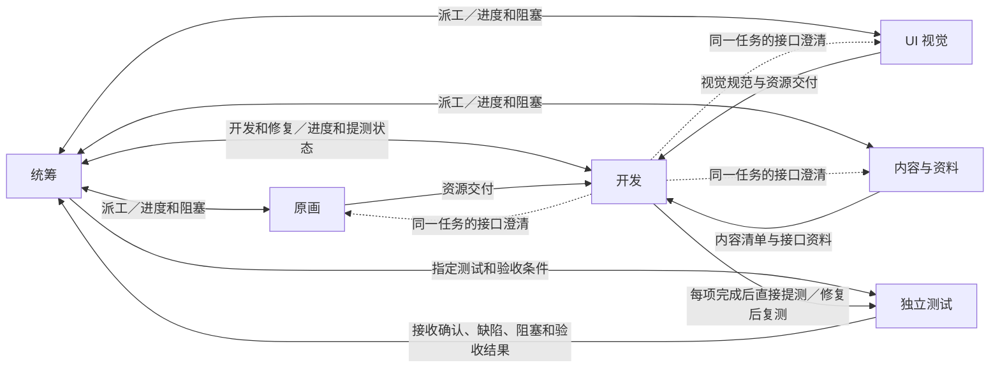

# 分工与关系网

| 职能 | 收件入口 |
| --- | --- |
| [[职能/统筹]] | [[收件索引#统筹]] |
| [[职能/原画]] | [[收件索引#原画]] |
| [[职能/UI 视觉]] | [[收件索引#UI 视觉]] |
| [[职能/内容与资料]] | [[收件索引#内容与资料]] |
| [[职能/开发]] | [[收件索引#开发]] |
| [[职能/独立测试]] | [[收件索引#独立测试]] |

职能可按实际需要拆分。细分职能沿用上级职能的交接方向，每次交接指定一个实际接收对话。
