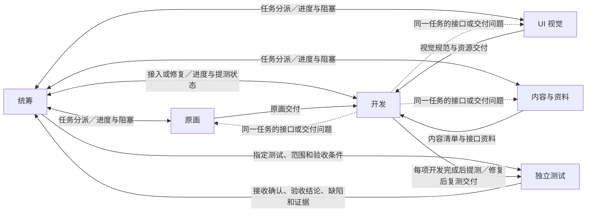

# 职能关系网与 Obsidian 笔记模板

建立项目分工、细分对话或确定允许的交接方向时使用。箭头表示消息的发件职能和接收职能。实际收件人以任务登记的对话为准。



- 新增需求、范围变更、改派与跨模块负责人选择走统筹。开发分支间需要直接对接时，在分工表中登记允许的方向、消息类型和负责接口。
- 统筹指定测试及验收条件。每项开发工作完成后，开发直接给指定测试写提测记录，关联版本、范围、入口、自测与已知缺口。测试把复现步骤、预期、实际、证据和未覆盖范围写给统筹。统筹按归属派发修复，开发完成后直接向指定测试提交复测记录，并关联原缺陷。
- 可根据实际职责细分原画与开发。分工表列出选择提示，例如「原画按角色、场景或单角色拆分」「开发按战斗、系统或其他模块拆分」。子职能保留上级职能的交接边界，并登记实际对话与接收人。

## 分工索引

用一张表登记实际负责对话。角色键使用项目内稳定的标识。收件入口可用独立笔记或可查询的索引。

| 角色键 | 上级职能 | 负责对话 | 负责与可改范围 | 交付对象 | 验收条件 | 收件入口 |
| --- | --- | --- | --- | --- | --- | --- |
| `<角色键>` | `<一级职能>` | `<已有对话入口>` | `<范围>` | `<接收角色键>` | `<可验证条件>` | `[[<收件索引>]]` |

## 任务与交接记录

任务笔记关联 `[[<分工索引>]]`，记录目标、范围、验收条件、已有改动、依赖和负责人。每次派工、交付或验收回报用一条有明确方向的记录，可单独建笔记或写入已有任务的专用小节。让接收方能从收件索引定位该记录。

```markdown
---
task_id: "<任务键>"
message_type: "<派工、接收确认、状态或阻塞回报、指定测试请求、接口澄清、交付、验收单、开发提测、复测交付或验收回报>"
from_role: "<发件角色键>"
to_role: "<接收角色键>"
message_status: "已发送"
---

- 关联任务 `[[<任务笔记>]]`
- 接收入口 `[[<接收角色的收件索引>]]`
- 目标、交付内容或待处理事项
- 产物入口、接口约定和验证证据
- 已知缺口、阻塞及下一步
- 接收确认、接入或验收结果
```

以同一任务关联原始交付、接入和测试结果。接收确认按关系网写入允许的方向。测试接收开发提测时，把确认写给统筹并链接原提测，由统筹更新接收状态。待接收事项留在对应收件入口，后续对话开始工作时读取。任务进度和验收结论单独记录在任务笔记。
